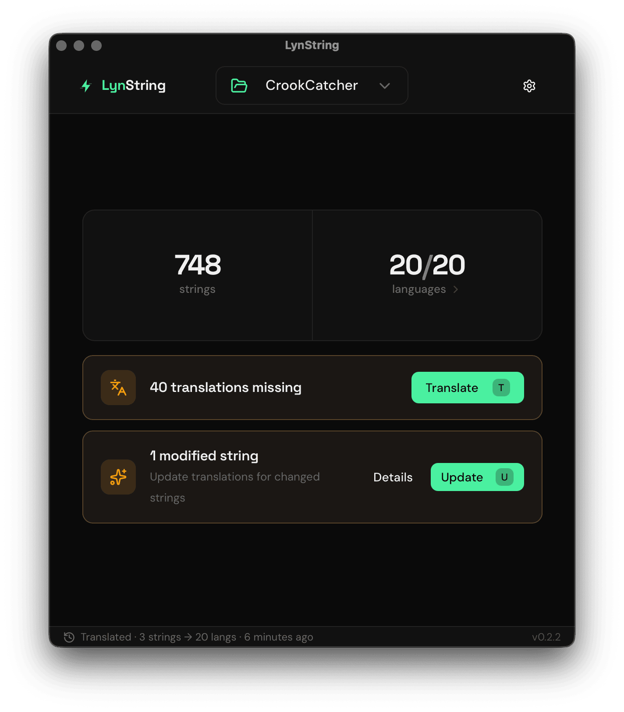
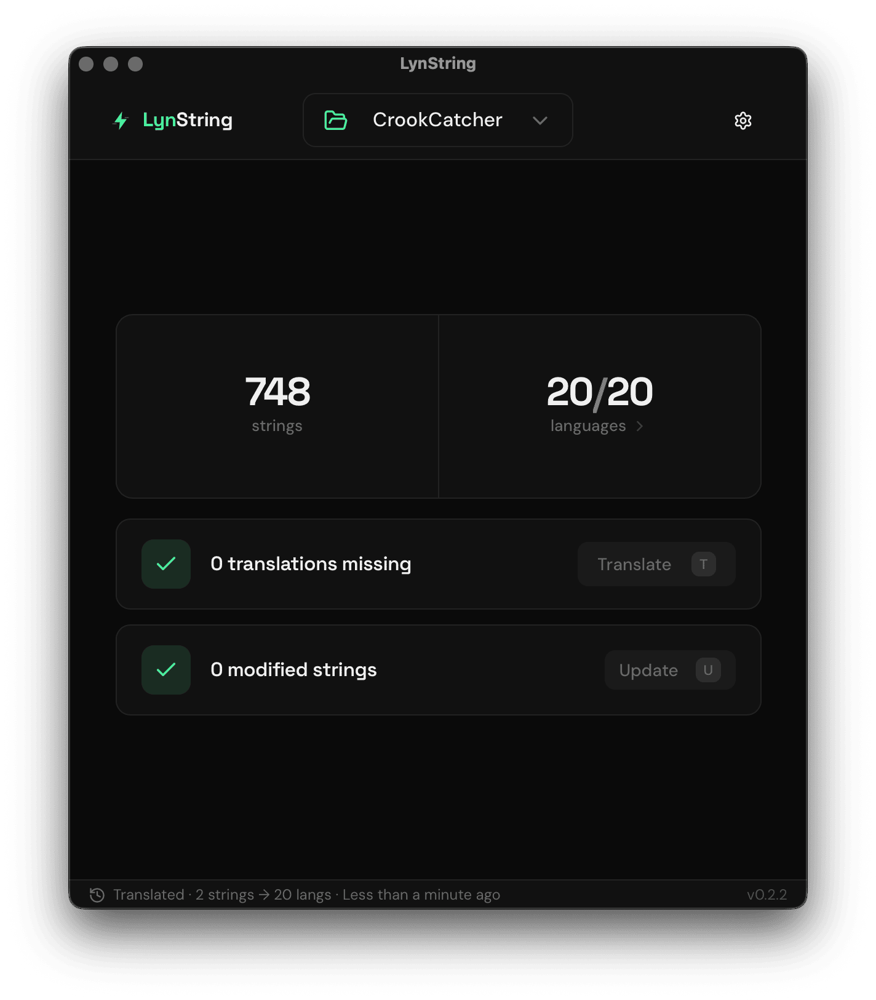

# LynString

A desktop app for translating Android apps. Point it at your Android project and it finds every
`values-xx/strings.xml`, shows what's missing or out of date, and translates it with Claude using
your own Anthropic API key.

<p align="center">
  
  &nbsp;
  
</p>

LynString started as a paid app. It's now free and open source: no account, no subscription, just
your own Anthropic API key.

## Features

- **Project overview** – reads `res/values/strings.xml` and every translation, and shows per language
  how many strings are missing.
- **Translate missing strings** into any number of languages at once, or add new languages.
- **Watches your project** – when you add or edit English strings, LynString notices and offers to
  translate or update them.
- **Android-safe output** – placeholders (`%1$s`, `%d`), `<xliff:g>`, HTML tags and CDATA are kept intact,
  and apostrophes, quotes, `@`, `?` and invalid `\u` escapes are escaped so the resources compile.
- **Wrong-language guard** – for languages with their own script (Hindi, Kannada, Arabic, Japanese, …)
  every batch is checked and retried if the model drifted into another language.
- **Clean-up tools** – find unused strings and strings that only exist in translations.
- **Your key, your model** – choose Claude Sonnet 5.5 (default), Haiku 5.5 (cheapest) or Opus 5.5.

## Requirements

- macOS, Windows or Linux
- [Node.js](https://nodejs.org/) 20 or newer and [pnpm](https://pnpm.io/installation)
- [Rust](https://www.rust-lang.org/tools/install) (stable)
- The [Tauri prerequisites](https://v2.tauri.app/start/prerequisites/) for your OS
  (Xcode Command Line Tools on macOS, WebView2 + MSVC on Windows, WebKitGTK on Linux)
- An [Anthropic API key](https://console.anthropic.com/settings/keys)

## Run it

```bash
git clone https://github.com/harteg/lynstring.git
cd lynstring
pnpm install
pnpm tauri:dev
```

The first build compiles the Rust backend and takes a few minutes; later starts are fast.

When the window opens:

1. Paste your Anthropic API key, pick a model and click **Save**. The key is tested before it's saved.
2. Click **Add Project** and choose your Android app's folder (the one containing `app/src/main/res`).
3. Pick the languages to translate and start.

You can change the key or model any time under **Settings → Change API key or model**.

### Build an installable app

```bash
pnpm tauri build
```

The app bundle (`.app`/`.dmg`, `.msi`/`.exe`, `.deb`/`.AppImage`) ends up in
`src-tauri/target/release/bundle/`. Builds are unsigned, so macOS will ask you to confirm the first
time you open it (right-click → Open).

## API key, models and cost

LynString calls `https://api.anthropic.com/v1/messages` directly with your key. There's no account,
telemetry or server of its own; the only other request is for the UI fonts from Google Fonts.

| Model | Price per million tokens (input / output) | Notes |
|---|---|---|
| Claude Sonnet 5.5 | $2 / $10 | Default. Good quality in all languages |
| Claude Haiku 5.5 | $0.10 / $0.50 | Cheapest; fine for most European languages |
| Claude Opus 5.5 | $4 / $20 | Most careful |

As a rough guide, translating ~800 strings into one language costs around $0.50 on Sonnet for a
European language and up to a few dollars for languages with non-Latin scripts (they use more
output tokens). Haiku costs about 20× less.

The key is stored in plain text in the app's data folder (`settings.json`, readable only by your user):

- macOS: `~/Library/Application Support/dev.lynstring.app/`
- Windows: `%APPDATA%\dev.lynstring.app\`
- Linux: `~/.local/share/dev.lynstring.app/`

If no key is saved, LynString falls back to the `ANTHROPIC_API_KEY` environment variable (or a `.env`
file in the directory you start it from, see `.env.example`).

## Development

```bash
pnpm check                    # Svelte/TypeScript type check
cd src-tauri && cargo test    # Rust unit and integration tests
```

`cargo test` includes one end-to-end test that calls the real API; it's skipped unless
`ANTHROPIC_API_KEY` is set.

Project layout:

```
src/                     SvelteKit frontend (Svelte 5, Tailwind, shadcn-svelte)
  lib/services/          translation flow, string loading
  lib/stores/            app state (projects, settings, history, …)
  lib/components/        UI
src-tauri/src/
  commands/translation.rs   batching, prompts, Anthropic API calls, Android escaping
  commands/strings.rs       reading and writing strings.xml
  commands/app_settings.rs  API key and model settings
  models/script.rs          expected script per language (wrong-language guard)
src-tauri/bindings/      TypeScript types generated from Rust (ts-rs)
```

After changing a Rust type that's exported to TypeScript, regenerate the bindings with
`cd src-tauri && cargo test export_bindings`.

## Contributing

Issues and pull requests are welcome. Please run `pnpm check` and `cargo test` before opening a PR.

## License

[GPL-3.0](LICENSE). You can use, modify and share LynString freely; if you distribute a modified
version, it must also be open source under the GPL.
